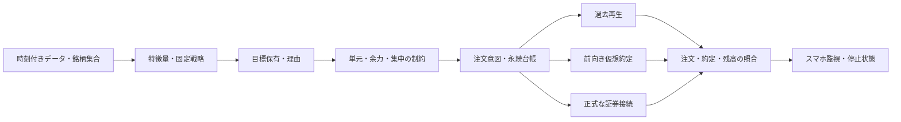

# シミュレーションから実売買までの設計・追加レビュー

2026-10-27。設計更新。目的は、日米の十分な候補からアルゴリズム・判断基準・配分を検証し、実行可能な候補をペーパー運用で確認した後に実売買へ進めること。今回の追加検討は成績の改善を実証したものではない。

[AIの仮説と根拠](ai-research-review.md) / [作業Issue一覧](research-issues.md) / [移行条件の草案](../research/promotion-policy.draft.json)

## 現状を点検して見つかった不足

| 現在の事実 | 最終目的との間にある不足 | 対応 |
| --- | --- | --- |
| 500候補の1,488設定を比較済み。ただし現在の生存銘柄・1年の参考試験 | 過去最高益だけでは将来の選択基準にならない | R11で目的・制約・選別順・不採用時の扱いを固定、R8で未見評価 |
| 価格・財務・技術仮説は整理済み | 相場変化、複数戦略の組合せ、保有継続・売却を独立して比較する計画が不足 | H4・H5を追加 |
| [500候補エンジン](../scripts/equity_screen.py)と[スマホのv1仮想売買](../src/engine.js)は別実装 | 研究結果を選択しても同じ売買が実行される保証がない | R12で共通の判断・注文意図・台帳と差分検証を設計 |
| 楽天RSSは国内株式等の注文と口座情報取得を公式に提供 | 米国株の正式な自動発注経路、Windows/Excel、無人継続性の確認が必要 | R13をP0で先行 |
| スマホは静的画面と端末内の仮想口座 | 画面を閉じた後の実行、本人認証付き操作、実際の停止確認が未実装 | R15で無料環境・認証・常駐・監視を設計 |
| 研究の採否とペーパー観察の計画はある | 統計面と注文・口座照合の両方に通過条件が必要 | R14で段階ごとの証拠、停止・復旧・拡大条件を固定 |

v1内では自動再生とバックテストが共通処理だが、それがPythonの500候補エンジンとの一致を意味するわけではない。新しい判断基準はスマホの「開始」を押すだけでは動かない。

## R11：「最適」の意味と選別手順

目標はS&P500を費用後で上回る成績を、許容できる損失と実行条件の中で目指すこと。将来の期待収益が確定したという表現はしない。10年100倍には積立なしで年率約58.49%が必要であり、その数字に合うまで探索・レバレッジを増やす目的関数にはしない。

最適と呼べるのは、固定した候補・データ・制約・選別方法の中の比較結果だけ。次の順序を事前固定する。

1. **失格条件を先に判定**：未来情報、対象集合の欠落を隠した比較、負の現金、買えない単元、超過集中、許容損失超過、データ欠損を利益へ変える処理、非対応の発注経路を除く。探索目的の試験は残せるが昇格候補と分ける。
2. **費用後の超過と安定性を評価**：複数の時間順区間の超過、最大下落、回復期間、回転率、費用増・遅延・近傍設定への耐性を併記。主評価指標・統合方法・不確実性の扱いを固定してから試す。
3. **同程度なら簡単な案を優先**：誤差範囲で近い候補から、ルール数・売買頻度・データ依存・運用負担の少ない案を選ぶ。複雑さも選別基準として記録する。
4. **基準に勝てなければ採用しない**：SPY買い持ち、事前固定の指数＋現金、現金待機を比較候補に置く。これは研究上の比較・運用案であり、検証失敗を契機にSPYを自動購入する実装ではない。

10/5/1年は同じ末日なら重複する。3本すべて上回っても独立した3回の成功として数えない。各期間を報告する一方、時間順の評価区間と最終評価は別に定義する。各1年に必ず勝つよう最適化すると、短期の偶然へ適合しやすい。

同じリスク水準の指数配分、国・業種・市場規模をそろえた基準とも比較し、米国比率や高ベータ・小型株・為替で説明される上振れを戦略固有の利益と区別する。課税口座・非課税制度・配当・外国税・売買回転の前提は別シナリオで表示し、税務上の扱いを一律に仮定しない。

年率の誤差を小数点まで最適化する前に、資金額・最大許容下落・1銘柄／業種上限・選別指標・評価長・不確実性基準を具体化する。ユーザーの「中〜高リスク」から特定の損失上限を合意済みと推定しない。未確定項目は草案に残し、昇格条件を満たした扱いにしない。

## H4：相場局面と複数戦略の組合せ

仮説は「異なる理由で利益を狙う戦略の固定組合せ、または単純な相場条件での配分が、単一案より不安定さを減らす」。未検証である。過去に最も良かった戦略へ毎回切り替えるだけでは、別の過適合を作る。

- 単一戦略、固定比率の組合せ、単純な市場トレンド／変動率条件を別々に比較する。まず固定比率を基準とする。
- 相場の名称を後から付けない。判定には当時利用できる指数・変動率・市場の広がりを使用し、改訂される経済指標は公表当時の版がなければ使わない。
- H1〜H3の全成功を待たず、適格な価格基準など事前指定した少数の構成要素で着手可能。入力を追加したら新しい実験にする。
- 業種内の相対順位や、市場・業種に連動する部分を除いた値動きを対照に置く。AI関連銘柄を多数持つだけの共通需要集中を測る。
- 売買頻度・現金待機・反発への乗り遅れ・急変時の同時下落を測る。危機時も過去の相関が維持されると仮定しない。
- 採否：同じ費用・リスク予算で比較し、複雑化と回転増に見合う未見区間の改善がなければ単純案を残す。数値閾値はR11/R8で実験前に固定。

## H5：成長を保有し続ける条件と売却条件

短期の押し目・業績イベントと、数年の構造的成長は時間軸が違う。10年の成長を狙うのに、毎月順位が変わるたび売る設計がよいかは別に検証する。

- 入場条件、保有継続条件、投資仮説の崩れ、価格の損失制限、配分上限による縮小を別々に記録する。
- 基準案の定期全再配分と、買い・継続の順位に差を設ける緩衝帯、長めの見直し、部分縮小、トレンド退出を少数の事前固定案で比較する。
- 仮説の崩れは当時の業績・受注・収益化の事実に限定する。現在の「AIの将来性」だけで悪化した保有を正当化しない。
- 高値からの下落、時間切れ、固定利確はそれぞれ検証対象。固定利確が大きな勝ちを切る可能性と、保有継続が利益を失う可能性の両方を測る。
- 配当・税シナリオ、売却費用、再購入、候補集合から外れた銘柄、損切り後の再参入も評価する。損切り幅は約定損失の上限ではない。
- 採否：期間別超過に加え、大幅上昇の捕捉、利益の吐き出し、回転、集中、最大下落が改善するか。現在の勝ち銘柄だけで退出ルールを作らない。

## R12：検証と実行が同じ判断をする構成

目標構成は以下。現時点で実装済みではない。

戦略は口座パスワードや注文APIを直接扱わず、時点付きデータと口座状態から注文意図を作る。実行器は数量・価格・商品・口座・余力・売買時間・モデル版を再確認する。同じ入力・台帳・設定で判断が一致することを検査し、実際の価格・部分約定が異なることまで同一と主張しない。

高速な近似探索は維持できるが、候補は共通台帳の詳細再生で再評価する。近似と詳細の注文・資金・費用の差分を保存し、差分許容値を結果を見る前に固定する。

注文意図には永続ID、モデル版、データ版、口座、銘柄、売買、数量、価格条件、有効期限、根拠、作成時刻を持たせる。通信前に保存し、証券側の発注ID・注文番号・約定IDを紐付ける。状態は未送信、送信中、受付、部分約定、全約定、取消待ち、取消済み、拒否、期限切れ、結果不明を区別する。

通信切断・再起動時は、送信済みか分からない注文を新しいIDで再送しない。まず注文・約定・残高を照合し、結果不明中は資金・数量を予約して新規リスクを増やさない。取消要求は取消完了ではなく、取消待ち中の約定も計上する。再計算・重複通知・並行実行は同じ注文意図を重複発注しない。

日米の時差、夏時間、休場、配当・分割、USD現金、買付余力、資金決済、手動取引も照合する。台帳不一致のままモデルを再開しない。

## R13：楽天証券の接続可能性を先に確認する

2026-10-27に公式ページを確認した範囲。実際の口座・Windows環境での検証は未実施。

| 確認項目 | 確認できたこと | 設計上の扱い |
| --- | --- | --- |
| 対応商品 | [RSS公式トップ](https://marketspeed.jp/ms2_rss/)は国内株式・先物／オプションを掲載 | RSSを日米株の共通発注経路としない。最初の検討対象は国内現物 |
| 動作環境 | [公式環境](https://marketspeed.jp/ms2_rss/system_requirements/)にWindows 11、Excel 2021/2024/365を掲載 | 現在のLinux・静的サイトだけでは動かない。既に保有するPC・Excelを使えるかは未確認 |
| 注文・取消 | [注文仕様](https://marketspeed.jp/ms2_rss/onlinehelp/ohm_002/ohm_002_06.html)に国内現物・訂正・取消等を掲載 | 商品・口座・注文条件を対応表にし、実証前に利用可能扱いにしない |
| 口座照合 | [注文約定仕様](https://marketspeed.jp/ms2_rss/onlinehelp/ohm_002/ohm_002_05.html)に注文・約定・保有・余力・発注ID・状態取得 | 再送前の照合、部分約定、手動変更の取り込みに使えるか実機確認 |
| 同時監視数 | [利用上限](https://marketspeed.jp/ms2_rss/onlinehelp/ohm_002/ohm_002_08.html)は市況情報の合計上限500を記載 | 日米500候補を同時にRSSへ流す設計ではない。市場・指数・為替の枠と関数別上限も確認 |

米国株は楽天での正式な自動発注方法を別調査し、対応未確認の間はシミュレーション／ペーパーの範囲に置く。国内だけの実売買を始める場合も、日米合算の過去成績を国内ポートフォリオの成績として使わず、国内限定の候補・基準・配分を再検証する。対応経路がなければ未対応と報告し、ログイン画面の自動操作で代用しない。

認証・利用同意・注文利用設定・セッション切れ・再ログイン・メンテナンス時刻・ツール更新・単元未満・口座区分・データ利用条件を、接続前に確認する。テスト環境や公式の模擬発注先があると仮定しない。最初の接続検証は、発注無効の読取・注文案照合とローカル模擬で行う。

無料制約は追加のデータ契約・API・サーバー費を発生させない方針。既存PC・Excel・回線の有無、常時稼働の電力・故障対応は未確認であり、無人実運用まで費用ゼロと保証しない。手数料・スプレッド・税は運用評価の費用として別に残す。

## R14：段階ごとの移行条件

| 段階 | 成果物・通過条件 | 未達時 |
| --- | --- | --- |
| G0 データ・接続の適格性 | 情報の利用可能時刻、範囲・欠測、商品・口座・接続能力表、無料運用の成立範囲 | 不足を明記して探索のみ。データ不足を黙って補わない |
| G1 探索と時間順評価 | プロトコル、全結果、費用後比較、未見期間、事前の数値基準への適合 | 保留・棄却。条件を緩めるなら新実験 |
| G2 詳細再生と障害試験 | 共通判断、整数数量、約定・資金台帳、再起動・重複・取消競合・停止等の検査 | 原因修正後、影響範囲を再検証 |
| G3 候補固定後のペーパー／発注無効観察 | 固定した日数と最低注文・イベント件数、原価差・遅延・欠測・照合記録、未解決注文ゼロ | 長さだけで合格にせず観察継続。売買機会がなければ不足 |
| G4 限定資金の実運用 | 確認済みの口座・市場・モデル版、具体的な資金／注文／損失上限、運用停止と復旧手順、開始記録 | 実発注を有効化しない |
| G5 拡大・継続・縮小 | 実際の約定差・費用・成績・障害と事前基準の比較、拡大後も単元・流動性を満たす | 拡大しない／縮小・停止。短期利益だけで上限を上げない |

統計的な優位性と運用の正常性は別の合格条件。60日等の一律の経過日数だけで優位性が証明されたとはしない。ペーパーは約定可能性を完全には証明しないため、G4でも実際の差を観測する。

金額・市場・損失上限が未確定な現在はG4の実行条件が揃っていない。「最終的に実売買」の目的を維持しつつ、具体的な口座設定と開始条件は成果物が揃った時点で確定する。今回の文書作成で実発注を有効にしない。

停止は3種類に分ける。「新規注文停止」「未約定注文の取消要求」「保有縮小／全決済」。通信不能時に取消・決済済みとは表示せず、停止要求と証券側確認を分ける。リスクを減らす注文も二重売却や売買停止で失敗し得るため、未解決状態の照合を続ける。

復旧はデータ鮮度、注文、約定、保有、余力、モデル版が一致してから行う。性能劣化とデータ・執行障害を区別し、障害時に戦略を自動再最適化しない。自動再開の可否と手順も開始前に固定する。

## R15：スマホ・無人実行・無料環境

スマホは監視と操作、実行器は別プロセスとする。ブラウザを閉じても動かすには、取得・判断・発注・照合を動かす端末が必要。無料ホスティングのスリープや一時的な開発環境を常時稼働の保証としない。

- 表示：研究／ペーパー／実運用を明確に分け、モデル版、対象市場、最新データ・最終接続時刻、注文・部分約定、照合不一致、損失・集中、停止要求／停止確認を表示する。
- 操作：本人認証とサーバー側の権限検査、操作ID・有効期限・監査記録を持ち、古い画面・再送・別タブから同じ指示を重複実行しない。証券の認証情報を静的JS、localStorage、公開Gitへ入れない。
- 故障：端末停止、回線断、認証期限切れ、無料枠停止、古い価格、通知未達を試す。画面が正常でも実行器が止まっていることを検出する。通知方法・到達確認は未実装。
- 保存：台帳・入力・モデル・操作ログのバックアップと復元を検証する。通信回復だけで古い注文をまとめて送らない。

UIから実注文のON/OFFだけを先に追加しない。実行器の状態と停止確認を表示できることが必要。

## 追加の実験品質と予測品質

研究結果の不確実性は、独立同分布の正規乱数だけで評価しない。時間のまとまりを保つ再標本化、急落・為替急変・売買不能・データ停止のシナリオ、上位寄与銘柄除外を別々に扱う。ストレス例は発生確率の推定ではない。少数の例外を除いて成績を良くするデータ修正をしない。

技術・業績の予測を売買に使うなら、予測時点、期限、予測対象、確率または範囲、根拠、実現値を保存する。方向の的中率だけでなく、確率の校正・予測幅と単純予測との比較を行う。予測が当たっても既に株価に織り込まれていれば収益にはならないため、予測評価と売買評価は分離する。

計算効率は、文書抽出と特徴量を一度だけ計算し、入力ハッシュ単位で再利用。小規模データで計算・約定の正しさを確認してから固定空間を一括試行し、候補だけ詳細再生する。途中結果に応じた打切り・探索変更も事前規則と全ログが必要。有料LLMで1設定ずつ判断しない。

## 直近の作業順

1. R11で比較目的と制約、R13で楽天・無料環境の能力表を先に具体化する。口座情報を取得せずに調べられる部分を先行。
2. R1/R2/R3で現在結果の監査・時点付きデータを進め、R8のプロトコルを固定する。
3. データが揃ったH1〜H5だけ実験する。未着手・情報不足の仮説が残っていても、独立した適格候補の評価を止めない。
4. R9/R12で実行可能な候補を詳細再生し、R10の前向き観察へ進む。条件に届く候補がなければ棄却・保留を成果として残す。
5. R14/R15の証拠が揃った範囲で、具体的な実運用開始と拡大を判断する。

追加の検討を無限に増やさず、次の成果物は「比較目的・接続能力表・データ不足一覧・実行前プロトコル」とする。実施する市場・戦略を狭める場合は、当初の日米全体の目標との差を記録する。
